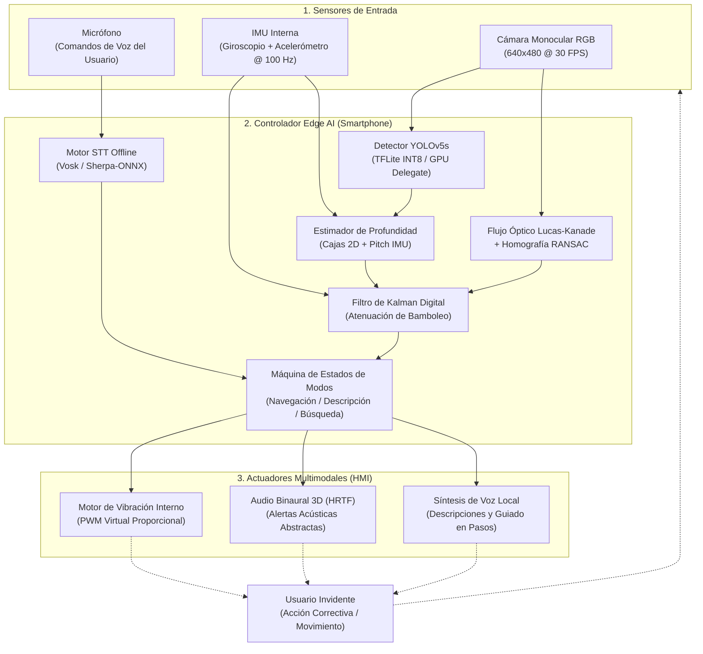

# PROYECTO — Sistema de Asistencia Multimodal en Tiempo Real Basado en Visión Computacional en Dispositivos Edge AI para la Autonomía y Orientación de Personas con Discapacidad Visual

Este documento ofrece una explicación exhaustiva y autocontenida de los fundamentos científicos, arquitectura de ingeniería, objetivos y planificación del proyecto para cualquier investigador o desarrollador que se incorpore al equipo.

---

## 1. Contexto y Problemática

A nivel global, la Organización Mundial de la Salud (OMS) estima que más de 2.2 mil millones de personas padecen discapacidad visual o ceguera total. Uno de los mayores desafíos en su vida cotidiana es la pérdida de autonomía para desplazarse en entornos dinámicos y no controlados.

Las herramientas de asistencia actuales presentan limitaciones severas:
1. **Bastón Blanco Tradicional:** Posee un alcance exclusivamente a nivel del suelo mediante contacto físico directo, siendo incapaz de alertar sobre obstáculos aéreos (ramas, letreros, ventanas abiertas) o cambios abruptos en la volumetría del entorno.
2. **Sistemas Dedicados y Estigmatizantes:** Dispositivos basados en chalecos ultrasónicos, cámaras estéreo fijadas a mochilas o sensores LiDAR portátiles resultan económicamente inaccesibles ($400 - $1,500+ USD), voluminosos y de alto consumo energético.
3. **Saturación y Fatiga Auditiva por TTS:** La mayoría de aplicaciones móviles comerciales bombardean al usuario con síntesis de voz continua (Text-to-Speech), lo cual bloquea la audición ambiental (esencial para que una persona ciega perciba peligros, pasos y tráfico) y causa una rápida fatiga cognitiva.
4. **Ruido Cinemático por Bamboleo de Marcha:** El paso humano introduce oscilaciones biomecánicas periódicas (1.0 a 2.0 Hz) que distorsionan gravemente las lecturas ópticas de una cámara monocular en un smartphone, generando continuos falsos positivos en los algoritmos convencionales de visión por computadora.

---

## 2. Objetivos del Proyecto (del Anteproyecto Oficial)

### Objetivo General
Desarrollar e implementar una aplicación móvil de asistencia basada en algoritmos de visión artificial local y procesamiento de señales inerciales, capaz de cartografiar el espacio físico en tiempo real para proporcionar guía de navegación autónoma, evasión de colisiones, descripción visual del entorno y búsqueda dirigida de objetos a personas con discapacidad visual.

### Objetivos Específicos
1. **Despliegue Edge AI a $\ge 25\text{ FPS}$:** Ejecutar localmente una arquitectura YOLOv5s optimizada y cuantizada (INT8/FP16) para dispositivos móviles comerciales, garantizando autonomía total sin dependencia de conectividad a la nube.
2. **Estimación de Profundidad Monocular Calibrada:** Diseñar un algoritmo matemático que correlacione la volumetría de las cajas de delimitación 2D y los datos vectoriales de la IMU interna (ángulos de inclinación) para calcular la distancia a obstáculos con un margen de error inferior al 5%.
3. **Filtro de Estabilización Cinemática de Marcha:** Implementar un filtro digital (Filtro de Kalman acoplado a homografía y flujo óptico Lucas-Kanade) que aísle el ruido biomecánico generado por el bamboleo de la marcha humana, reduciendo los falsos positivos de proximidad en más de un 80%.
4. **Interfaz HMI Multimodal Voice-First no Invasiva:** Desarrollar una interfaz háptica-auditiva activada 100% por voz que modulará la vibración del motor interno del smartphone por PWM virtual y renderizará alertas acústicas abstractas en 3D binaural (HRTF) sin saturar con voz TTS continua.

---

## 3. Estado del Arte: Brecha, Desafío y Argumento Central

### Brecha
Ningún trabajo previo en la literatura logra resolver en un único smartphone comercial y accesible (sin mochilas, cámaras estéreo externas ni servidores remotos) la estabilización del bamboleo de la marcha humana fusionada con estimación monocular de profundidad métrica y una interfaz multimodal Voice-First no invasiva que integre navegación, descripción de escena y búsqueda dirigida de objetos cotidianos.

### Desafío Técnico
Separar el movimiento propio de la cámara del movimiento de los objetos en la escena bajo un presupuesto computacional estricto en la CPU/GPU móvil; resolver la ambigüedad de escala métrica monocular; y orquestar en tiempo real la inferencia neuronal, el filtrado de Kalman y el reconocimiento de voz offline sin estrangulamiento térmico ni latencia perceptible.

### Argumento Central (Hipótesis Tesis)
> *«La integración de un lazo de control cerrado en dispositivos móviles comerciales mediante la fusión de visión monocular (YOLOv5s optimizado en Edge AI) y variables cinemáticas de la IMU interna, filtradas digitalmente mediante flujo óptico y un Filtro de Kalman, permite estimar la distancia métrica a obstáculos con un error inferior al 5% a una tasa $\ge 25\text{ FPS}$ sin dependencia de la nube, y posibilita una interacción multimodal Voice-First (retroalimentación háptica proporcional y audio 3D binaural) que reduce significativamente el tiempo de despeje y las colisiones sin inducir fatiga cognitiva ni saturar el canal auditivo ambiental del usuario invidente.»*

### Contribuciones Principales
1. Fusión sensorial Edge AI (cámara monocular + IMU) con atenuación de ruido cinemático por marcha humana mediante Filtro de Kalman y transformaciones homográficas.
2. Algoritmo geométrico monocular de estimación de profundidad métrica con error $<5\%$ en el rango de 0.5 a 4.0 metros.
3. Arquitectura HMI Voice-First multimodal (vibración proporcional PWM virtual + audio 3D binaural) con 3 modos funcionales: Navegación Activa, Descripción de Escena y Búsqueda Espacial de Objetos.

---

## 4. Arquitectura General del Sistema

El sistema opera como un lazo de control cerrado en tiempo real:

---

## 5. Stack Técnico y Plataforma

- **Dispositivo:** Smartphone comercial Android (gama media/alta con SoC Snapdragon/Dimensity).
- **Lenguajes:** Kotlin 1.9+ y C++17 (NDK r25+ con CMake).
- **IA / Visión:** TensorFlow Lite 2.14+, OpenCV 4.8+ C++, Eigen 3.4.
- **Voz:** Vosk Android SDK (modelo acústico en español offline < 50 MB) y Android TTS nativo offline.
- **Audio y Háptica:** Google Resonance Audio SDK / OpenSL ES (HRTF 3D) y Android VibratorManager API.

---

## 6. Publicación Objetivo

- **Destino Principal:** *IEEE Access* (JCR Q2 / Scopus Q1, Open Access).
- **Destino Alternativo:** *MDPI Sensors* (Special Issue on Navigation and Sensory Systems).
- **Idioma:** Inglés.
- **Formato:** IEEE Transactions a doble columna (10 a 14 páginas).

---

## 7. Plan de Hitos y Ruta Crítica

- **[H01]** Captura sincronizada de Cámara monocular e IMU a 100 Hz.
- **[H02]** Inferencia Edge AI con YOLOv5s cuantizado a $\ge 25\text{ FPS}$.
- **[H03]** Estimación monocular de profundidad y supresión de bamboleo con Filtro de Kalman.
- **[H04]** Interacción Voice-First embebida 100% offline.
- **[H05]** Retroalimentación háptica (PWM) y audio espacializado 3D binaural.
- **[H06]** Orquestación de modos de aplicación (Navegación, Descripción y Búsqueda).
- **[H07]** Benchmarking computacional y calibración metrológica con telémetro láser.
- **[H08]** Evaluación experimental con voluntarios vendados (tiempo de despeje, colisiones, SUS y NASA-TLX).

**Ruta Crítica:** `H01 -> H02 -> H03 -> H06 -> H08`.

---

## 8. Supuestos, Restricciones y Puntos [POR DEFINIR]

### Supuestos de Trabajo
1. El smartphone se porta fijado al pecho mediante un arnés elástico simple o cordón seguro a la altura del esternón ($H_c \approx 1.30\text{ m}$) durante la navegación activa.
2. El usuario emplea auriculares de conducción ósea (*bone-conduction*) o audífonos de oído abierto para no bloquear los sonidos ambientales del entorno.

### Restricciones
1. Autonomía total: 0% dependencia de servidores en la nube o conexión a internet para la operación básica.
2. Sin hardware adicional costoso: se utiliza exclusivamente el teléfono comercial del usuario.

### Puntos [POR DEFINIR]
- `[POR DEFINIR 1]`: Ajuste dinámico de altura para obstáculos aéreos suspendidos (ramas/letreros) que no tocan el suelo.
- `[POR DEFINIR 2]`: Calibración adaptativa de la longitud del paso del usuario para la guía en pasos en el Modo Búsqueda.
- `[POR DEFINIR 3]`: Umbrales de iluminación mínima nocturna y encendido automático de la linterna LED auxiliar en baja visibilidad.
